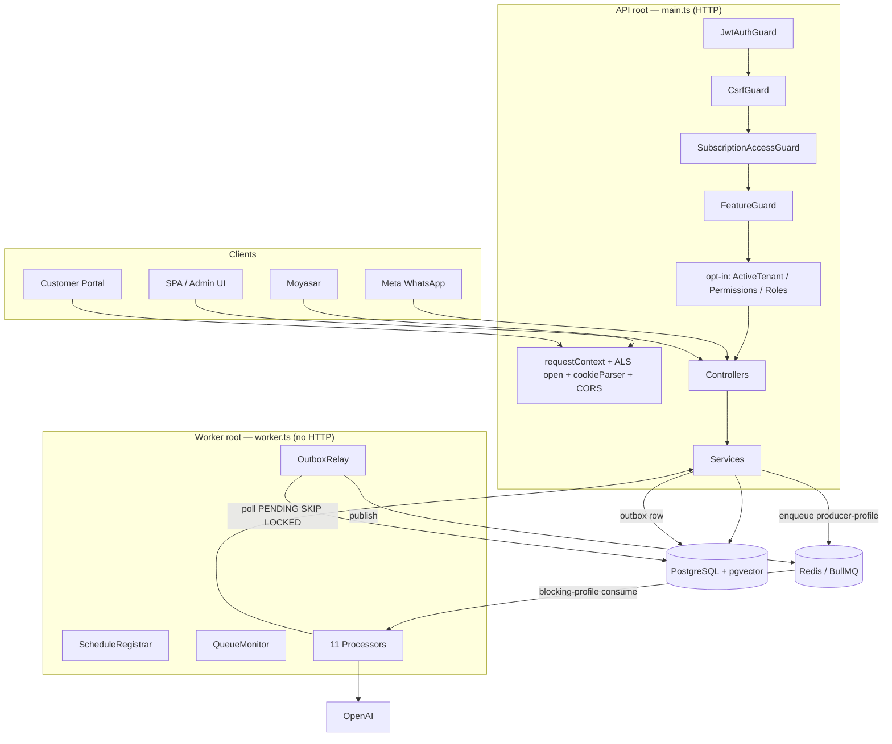
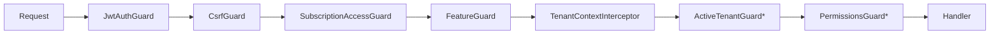
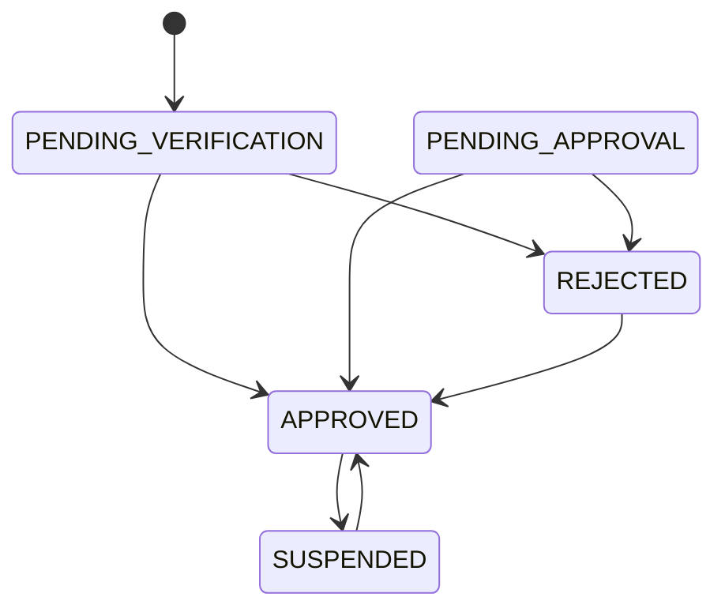

# Ziyarati Backend — Architecture (Code-Derived)
main.ts
│
├── NestFactory
│      ↓
│   إنشاء التطبيق
│
├── AppModule
│      ↓
│   تحميل كل Modules
│
├── ValidationPipe
│      ↓
│   التحقق من كل Requests
│
├── cookieParser
│      ↓
│   قراءة Cookies من الطلب
│
├── requestContext
│      ↓
│   إنشاء Context خاص بالطلب الحالي (مثل Request ID أو Tenant)
│
├── TenantContextService
│      ↓
│   تحديد المستأجر (Tenant) الحالي في مشاريع Multi-Tenant
│
├── AllExceptionsFilter
│      ↓
│   توحيد شكل الأخطاء الصادرة من التطبيق
│
└── SwaggerModule
       ↓
    إنشاء وتقديم توثيق الـ API على /docs


                      NestJS
                     │
        ┌────────────┴────────────┐
        │                         │
        ▼                         ▼
      API                    Worker Process
        │                         │
        ▼                         ▼
 QueueService               @Processor(...)
        │                         │
        ▼                         ▼
 ProducerQueues          Worker Connection
        │                         │
        └────────────┬────────────┘
                     ▼
                  Redis
        ┌──────────┼──────────┐
        │          │          │
        ▼          ▼          ▼
   Producer    Worker     QueueEvents
  Connection  Connection   Connection

                      Queue Constants
                           │
          ┌────────────────┴────────────────┐
          │                                 │
          ▼                                 ▼
      QUEUE Names                     JOB Names
          │                                 │
          └────────────────┬────────────────┘
                           ▼
                  Queue.add(jobName)
                           │
                           ▼
                         Redis
                           │
                           ▼
                      BullMQ Worker
                           │
          ┌────────────────┼────────────────┐
          │                │                │
          ▼                ▼                ▼
     Retry Logic      Concurrency      Rate Limiter
          │                │                │
          └────────────────┼────────────────┘
                           ▼
                   Exponential Backoff
                    + Random Jitter
                           │
                           ▼
                    Dead Letter Queue
    
> **Status:** derived directly from the implementation (`src/**`) and the committed
> migrations (`src/migrations/*`), not from any prior AI-generated catalogue.
> Where a prior document and the code disagreed, the code won. Physical schema:
> see [`docs/schema/schema.sql`](./schema/schema.sql).

A multi-tenant clinic SaaS backend: **NestJS 11 + TypeORM + PostgreSQL (pgvector) +
BullMQ/Redis**, deployed as **two process roots** — an HTTP API (`src/main.ts`) and a
background worker (`src/worker.ts`) — that share identical DB/queue/tenant-context wiring
but only the worker runs job processors.

---

## 0. How to read this codebase (start here)

Read in this order:

1. `src/main.ts` + `src/app.module.ts` — request pipeline and the global guard stack.
2. `src/rbac/rbac.constants.ts` — the entire authorization contract on one page.
3. `src/common/errors/*` + `common/filters/all-exceptions.filter.ts` — canonical error shape.
4. `src/core/tenant-context/*` — how tenant identity flows through HTTP **and** jobs.
5. `src/queue/*` + `src/worker/*` — the async backbone.
6. `src/entities/enums.ts` — every lifecycle state machine in one file.
7. Then the depth modules by subtlety: `appointment.service` → `payment-webhook.service`
   → `campaign-dispatch.service` → `ai-execution.service`.

The five flows that define the system:

1. **Booking** — `AppointmentsService.create` → `AvailabilityService.assertBookable`
   (in-transaction) → DB `EXCLUDE` constraint backstop.
2. **Payment truth** — Moyasar webhook → verify → atomic dedup → reconcile-vs-ledger →
   settlement clawback.
3. **Campaign send** — launch → keyset fanout → CLAIM/GATE/SEND/CLASSIFY/PERSIST with
   per-tenant rate limiting + DLQ.
4. **AI turn** — quota → RAG → tool-calling loop (real booking actions) → atomic
   usage/cost → timeline mirror.
5. **Durability** — outbox relay + `notifications.reap`/`refunds.reap` sweeps reclaim and
   replay anything a crash left in-flight.

**Mental model:** state changes are written to the DB (often with an outbox row); the
worker turns them into provider actions idempotently; every money/availability/send
invariant has both an application check **and** a database-level guarantee.

---

## 1. System Topology



Graceful shutdown: `worker.ts` traps SIGTERM/SIGINT → `app.close()` → BullMQ workers
finish in-flight jobs before exit.

---

## 2. Corrections to the prior catalogue

| # | Prior claim | Code reality | Severity |
|---|---|---|---|
| 1 | "JWT global guard; `@Public()` opt-out" | **Cookie-first** auth (HttpOnly `access_token`); Bearer only in non-prod. **Four global guards** (Jwt, **Csrf**, SubscriptionAccess, Feature) + opt-in ActiveTenant/Permissions/Roles. Refresh **rotation + reuse-detection family revoke**. | High |
| 2 | "8 queues" | **13 queues**: notifications (+`.dlq`), whatsapp, **3-stage campaign pipeline** (`launch`/`fanout`/`processRecipient` + `.dlq`), ai, analytics, settlements, subscriptions, refunds, **platform**. | High |
| 3 | "5 repeatable jobs" | **8**: missed `analytics.cleanup`, `notifications.reap` (every minute), `platform.logCleanup`. | Medium |
| 4 | — | **Transactional outbox** (`OutboxJob` + `OutboxRelayService`, `FOR UPDATE SKIP LOCKED`). | High |
| 5 | — | **Per-tenant rate limiting** via atomic Redis Lua token-bucket. | High |
| 6 | Campaign = single status | **Dual-axis**: `CampaignLifecycle` × `CampaignExecution`; recipients `RecipientProcessing` × `RecipientDelivery`. | High |
| 7 | Appointment merges "paid" into status | **Two axes**: `AppointmentStatus` × `AppointmentPaymentStatus`; double-booking blocked by a Postgres `btree_gist` EXCLUDE constraint. | High |
| 8 | "WhatsApp sender is noop" | Real `MetaWhatsappProvider`, hybrid CUSTOM→PLATFORM router, **fail-closed** HMAC-SHA256 verifier. | Medium |
| 9 | "webhook deduplicated" | Atomic dedup (partial unique index), **refund-ledger reconciliation**, anti-tampering amount/currency checks, **settlement clawback-if-settled**, secret sanitization. | High |
| 10 | "Patient missing from canonical-schema.sql" | **No such file** — schema is migration-driven. `Patient` is a real entity. The "discrepancy" was an artifact. | Medium |

---

## 3. Modules

### 3.1 Core infrastructure

**Tenant Context** (`src/core/tenant-context`) — `TenantContextService` (AsyncLocalStorage
singleton, not request-scoped), `TenantContextInterceptor` (populates principal post-auth),
`ActiveTenantGuard` (Layer-3 tenant gate; bypass via `@AllowInactiveTenant()`),
`TenantLookupService`. Key methods: `run(cb)`, `requireTenantId()`, `isSuperAdmin()`
(`tenantId === null && roles ∋ super_admin`). The ALS store is opened by middleware in
`main.ts` before the Nest pipeline. **Ordering coupling:** the billing guards read
`request.user` (not ALS) because they run before the interceptor populates ALS.

**Queue + Worker** (`src/queue`, `src/worker`) — three Redis connection profiles:
- **blocking** (`maxRetriesPerRequest: null`) — shared default the BullMQ explorer hands to every `Worker`.
- **producer** — dedicated `Queue` instances (`ProducerQueues`) for enqueue isolation.
- **events** — `QueueEvents` in `QueueMonitorService`.

Key classes: `QueueService` (single producer facade; stamps `correlationId`+`actorId`;
**deterministic jobIds** = queue-layer idempotency; `publish()` relay primitive;
`addRepeatable()`), `TenantRateLimiterService.consume` (one Lua round-trip: token bucket
**+** daily/monthly caps; `RATE`=transient, `*_CAP`=terminal), `OutboxRelayService.drainBatch`
(`SELECT … FOR UPDATE SKIP LOCKED LIMIT 100`), `ScheduleRegistrarService` (8 repeatables,
try/catch so a boot Redis blip doesn't crash), `QueueMonitorService` (per-queue events +
DLQ depth alert), `WorkerTenantsService.activeTenantIds` (sweep fan-out directory).

**Common** (`src/common`) — `AppError` + `ErrorCode` (machine-readable contract),
`mapTypeOrmError` (23505→`UNIQUE_VIOLATION`…), `AllExceptionsFilter` (single error shape,
`requestId`, sanitized body logging, no stack/SQL leak in prod, optimistic-lock 409),
`requestContext` middleware (correlation id), `decimal.transformer` (exact money).

### 3.2 Auth & RBAC (`src/modules/auth`, `src/rbac`)

Cookie-first auth: `JwtStrategy` extracts from the HttpOnly `access_token` cookie (Bearer
only in non-prod), and **re-resolves the live user every request** via
`AuthService.buildAuthenticatedUser` — roles/permissions are always fresh, never trusted
from the token body.

`AuthService` highlights: `registerOwner` (atomic tenant `PENDING_VERIFICATION`/inactive +
owner user + role), `createTenantUser` (admin-only; tenant from principal, never body;
enforces `max_users`), `login`/`validateCredentials` (bcrypt-12; uniform
`INVALID_CREDENTIALS`), `refresh` (**rotation**; revoked/forged token → **revoke whole
family**), `forgotPassword` (anti-enumeration), `resetPassword`/`changePassword` (revoke all
sessions). Separate access/refresh secrets; refresh persisted with `jti` + sha256 hash.

`CookieService`: `access`→`/api/v1`, `refresh`→`/api/v1/auth` only, `csrf` SPA-readable
(double-submit). `CsrfGuard` checks header==cookie only on state-changing, cookie-authed
requests (webhooks/bearer clients exempt).

RBAC contract (`rbac.constants.ts`, single source of truth): dot-notation permissions,
snake_case roles, `ROLE_PERMISSIONS` with `*` sentinel for `super_admin` (PermissionsGuard
short-circuits). `OWNERSHIP_SCOPED_PERMISSIONS` (`appointments.read_own`,
`profile.update_own`) are **ABAC** — require service-layer ownership checks. Seeder
**reconciles** to exactly the contract (idempotent).


`*` = opt-in per controller.

### 3.3 Tenant (`src/modules/tenant`)

Aggregate root: profile, 1:1 settings (lazy-created), branches, verification documents,
**audited approval state machine** (`TenantService.transition` enforces an explicit
`ALLOWED` map + writes a `TenantApprovalEvent` per change).


**Note:** no path in `TenantService` enters `PENDING_APPROVAL` — likely the
verification-document review bridges it, or it is currently unreachable (confirm).

### 3.4 Subscription-Billing (`src/modules/subscription-billing`)

`AccessControlService` is the platform's single access authority (dependency-free to avoid
cycles): `resolveAccess` priority = **global FREE mode → active free override → usable
subscription**. `assertUsable` (403), `isEnforced` (false under free/override → quotas &
features not enforced). Enforced by two **global** guards: `SubscriptionAccessGuard`
(`@RequireActiveSubscription()`) and `FeatureGuard` (`@RequireFeature()`). `UsageService`
gates appointments/AI-tokens/users. Super-admin admin via plan-admin / billing-mode /
free-access-override.

### 3.5 Appointment (`src/modules/appointment`)

Two orthogonal axes: `AppointmentStatus` (scheduling) and `AppointmentPaymentStatus`
(payment). `AppointmentsService` enforces tenant isolation in every method (cross-refs
re-loaded tenant-scoped). `create`: quota → validate refs → `availability.assertBookable(…
{manager})` **inside the txn** → snapshot `booked_timezone` + service price/duration → audit.
`changeStatus` enforces `ALLOWED_TRANSITIONS`; `cancel`/`reschedule` are dedicated paths;
`getTimeline` merges all audit tables; `remove` soft-deletes only terminal records.

**DB backstop:** `appointments_no_overlap` — `EXCLUDE USING gist (staffId WITH =,
tstzrange(start_at,end_at,'[)') WITH &&) WHERE status NOT IN (CANCELLED,NO_SHOW) AND
deleted_at IS NULL`. App check + DB constraint = defense in depth (collision → `23P01` → 409).

### 3.6 Payments (`src/modules/payments`)

Provider seam: `PaymentGatewayProvider` → `MoyasarProvider` / `NoopGatewayProvider` (factory
falls back to Noop when no key). `PaymentWebhookService.handleMoyasar` hardening:

1. Authenticate (`MoyasarWebhookVerifier`, constant-time, **fail-closed in prod**).
2. Resolve payment by `gateway_payment_id`; **tenant from the payment row, never the body**.
3. **Atomic dedup** (`recordWebhookOnce`, partial UNIQUE `uq_txn_webhook_event`).
4. **Refund reconciliation** — never flips REFUNDED directly; compares gateway cumulative
   `refunded` vs the Refund ledger, appends a delta, clamps `[0, paymentCents]`.
5. **Clawback** — reconciled refund on a settled payment nets out of next settlement.
6. **Anti-tampering** — honors `paid` only if reported amount **and** currency match.
7. **Sanitization** — strips `secret_token` before persisting to the tenant-readable ledger.

Settlement (`UNSETTLED/IN_BATCH/SETTLED` on payment) and payout (`PENDING/PROCESSING/PAID/
FAILED` on settlement) are separate axes. `transactions` is append-only (immutability
trigger). The `settlements` sweep fans out per-tenant; "nothing to settle" = no-op.

### 3.7 WhatsApp (`src/modules/whatsapp`)

Provider seam (`MetaWhatsappProvider`/`NoopWhatsappProvider`), router
(`WhatsappMessageRouter.resolveForSend`: explicit account → branch CUSTOM → branch PLATFORM
→ env PLATFORM), `WebhookSignatureVerifier` (HMAC-SHA256 over **raw body bytes**;
`rawBody: true` in `main.ts`; **fail-closed**, no dev bypass; GET `hub.challenge` handshake).

### 3.8 Conversations (`src/modules/conversations`)

The **unified message timeline** (inbox/search/analytics read this), distinct from the AI
engine's `ai_messages` store. `ConversationExecutionService.recordChannelMessage` is the
mirror target the AI engine writes BOT/CUSTOMER turns into. Lifecycle BOT→OPEN→ASSIGNED→
RESOLVED→CLOSED (+ARCHIVED). Hardening adds inbound dedup + message tamper-block.

### 3.9 AI (`src/modules/ai`)

`AiExecutionService.sendMessage`: quota pre-check → persist user msg + mirror → **RAG
retrieve** (pgvector or keyword fallback) → assemble prompt (system + KB + last-20) →
**tool-calling loop (≤4 iters)** through `AiToolDispatchService` (reuses Appointment/
Scheduling; **tenant-bound from context, never model args**) → final answer → **atomic**
usage/cost (`INSERT … ON CONFLICT DO UPDATE`). LLM round-trips deliberately **not** in a DB
txn; only the final write + metering are. Noop provider → plain Q&A. Handover: PENDING→
ASSIGNED→ACCEPTED→RESOLVED (or REJECTED).

### 3.10 Campaigns (`src/modules/campaigns`)

Pipeline: `campaigns.launch` → `campaigns.fanout` (keyset windows → `addBulk`) →
`campaigns.processRecipient` (high concurrency + global limiter + expo-jitter) →
`campaigns.dlq`. `CampaignDispatchService.dispatch` 5 steps: **CLAIM** (atomic
PENDING→DISPATCHING, `provider_ref IS NULL`; 0 rows = idempotent no-op) → **GATE** (run
PROCESSING? DRAINING→release+defer never skip; rate/caps) → **SEND** (only IO) → **CLASSIFY**
(`TransientDispatchError`→retry→DLQ; `PermanentDispatchError`→record no retry) → **PERSIST**
(atomic run counters `GREATEST(queued-1,0)` + completion flip when
`sent+failed+skipped ≥ total_recipients`). Idempotency floors: deterministic jobId, CLAIM
guard, UNIQUE `provider_ref` (collision reconciled as sent).

```mermaid
stateDiagram-v2
  direction LR
  state "Campaign (business)" as B {
    DRAFT --> SCHEDULED --> ACTIVE --> PAUSED --> ARCHIVED
  }
  state "Run (system)" as R {
    IDLE --> ENQUEUEING --> PROCESSING --> COMPLETED
    PROCESSING --> DRAINING --> COMPLETED
    PROCESSING --> FAILED
  }
```

### 3.11 Notifications (`src/modules/notifications`)

`NotificationDispatchService.processScheduled` = atomic-claim send (TRANSIENT→retry→DLQ,
PERMANENT→in-band). **`notifications.reap` every minute** reclaims stale `PROCESSING` +
re-enqueues due-but-unsent rows (crash recovery). Rate-limited → `moveToDelayed` without
consuming an attempt. WhatsApp channel integrated.

### 3.12 Analytics (`src/modules/analytics`)

Event ingestion, dashboards, daily/monthly reports. `AnalyticsCacheService` (Redis,
**fail-open** to DB), `AnalyticsRetentionService`, `analytics-schema.bootstrap` (indexes +
dashboard uniqueness), idempotent upserts, primary-branch attribution. Repeatables: report
00:30, aggregate hourly, cleanup 03:15.

### 3.13 CRM / Staff / Scheduling / Platform (CRUD-shaped)

- **CRM** — `Customer` aggregate + profile/address/note/tag/file/review. B2C `Customer` is the booking subject (distinct from `Patient` and RBAC `User`).
- **Staff** — profiles, services, schedules, working hours, time-off, commissions, ratings, branch assignment.
- **Scheduling** — `AvailabilityService.assertBookable` (the single booking gate used by Appointment **and** AI tools), slots, blocked slots, holidays.
- **Platform** — API keys, API/webhook logs, file metadata, system settings; `platform.logCleanup` sweep.

---

## 4. Database

~95 entities, **migration-driven** (no `synchronize` in prod). FK columns are **camelCase**
(default naming strategy) — raw query-builder strings must match. Money = exact `numeric`.
Full DDL: [`docs/schema/schema.sql`](./schema/schema.sql).

**Business rules enforced by the database (not just app code):**

| Rule | Mechanism | Migration |
|---|---|---|
| No double-booking per staff | `btree_gist` EXCLUDE on `(staffId, tstzrange[) )` | AppointmentNoOverlap |
| Webhook processed once | partial UNIQUE `uq_txn_webhook_event` | PaymentsLedger |
| One send per recipient | UNIQUE `provider_ref` (partial) | CampaignExecutionRedesign |
| AI usage/cost no lost updates | UNIQUE keys + `ON CONFLICT` | AiToolCalls / baseline |
| Ledger immutability | `trg_transactions_immutable` trigger | PaymentsLedger |
| RAG | `vector(1536)` + pgvector | AiPgVector |

---

## 5. Security

**Strengths:** secure-by-default global auth; cookie scoping + rotation + theft response;
anti-enumeration; bcrypt-12; constant-time + fail-closed webhook verification; tenant
derived from server-side rows never bodies; no secret/stack/SQL leakage in prod;
append-only financial ledger.

**Findings (actionable):**

1. **`JWT_REFRESH_SECRET` is not in `env.validation`** and falls back to
   `'dev-refresh-secret'` if unset, while `JWT_ACCESS_SECRET` is required. An env that sets
   only the access secret signs refresh tokens with a public default. *(Reported, not yet
   fixed — fix: require it, drop the default.)*
2. `JWT_EXPIRES_IN` is validated but **unused**; code reads `JWT_ACCESS_TTL` (default 15m).
3. Moyasar verifier has a dev "accept-all" bypass (WhatsApp does not) — asymmetric.
4. **No login/brute-force throttling** — only the campaign/notification send paths are
   rate-limited; the token-bucket primitive already exists and could be reused.
5. ABAC ownership correctness relies on each service remembering to check ownership
   (convention, not a guard).

---

## 6. Event & Queue Architecture

13 queues; 8 repeatable cron jobs; transactional outbox; per-tenant rate limiting.

```mermaid
graph TB
  subgraph Scheduled["8 repeatables"]
    A1[analytics.report 00:30]
    A2[analytics.aggregate hourly]
    A3[analytics.cleanup 03:15]
    S1[settlements 01:00]
    SU[subscriptions 02:00]
    RF[refunds.reap */5m]
    NR[notifications.reap */1m]
    PL[platform.logCleanup 03:30]
  end
  CL[campaigns.launch] --> CF[campaigns.fanout] --> CP[campaigns.processRecipient] --> CDLQ[campaigns.dlq]
  ND[notifications] --> NDLQ[notifications.dlq]
  OUT[(outbox_jobs)] --> REL[OutboxRelay SKIP LOCKED] --> Q[(Redis)]
  Scheduled --> Q
  CP --> Q
  Q --> P[Processors] -->|fan-out per tenant| Q

**Uniform retry/DLQ semantics:** rate-limit → `moveToDelayed` (no attempt consumed);
TRANSIENT → backoff → on exhaustion **reconcile terminal state THEN park in DLQ** (so
runs/sweeps never hang); PERMANENT (`UnrecoverableError`) → fail, no retry, no DLQ. Sweep
jobs (`tenantId: null`) fan out per active tenant. Defaults: 5 attempts, exponential 3s,
`removeOnComplete {1h,1000}`, `removeOnFail {7d,10k}`.


## 7. Technical Debt

| Area | Debt | Impact |
|---|---|---|
| Config | `JWT_REFRESH_SECRET` unvalidated; `JWT_EXPIRES_IN` dead; `dev-*` secret fallbacks | Security + confusion |
| Auth | No login/brute-force throttling | Account-security gap |
| Queue | `QueueService` borrows the `notifications` queue's Redis client for KV/rate-limiter/ping | Noisy-neighbor coupling |
| Tenant | `PENDING_APPROVAL` has no inbound transition | Possible dead state |
| Enums | Deprecated `CampaignStatus`/`RecipientStatus` still exported | Drift risk |
| FK naming | camelCase FK columns + raw QB strings | Latent bug surface |
| Module size | Payments (40+), AI (50), WhatsApp (38) files | Onboarding friction |
| Provider IO | Real Moyasar/Meta paths reach `globalThis.fetch` via `any`, untested in dev (Noop) | Untested real path |
| Tests | Only `app.controller.spec` + e2e scaffold; hardened money/queue logic has no unit tests | Regression risk |


## 8. Refactoring Recommendations (harden what exists; no redesign)

1. Env contract: require `JWT_REFRESH_SECRET` (no default); remove dead `JWT_EXPIRES_IN`;
   fail boot if any `*_SECRET` equals a `dev-*` default in production.
2. Dedicated rate-limiter/KV Redis client instead of piggybacking the `notifications` queue.
3. Login throttling using the existing token-bucket primitive.
4. Promote ABAC ownership to a reusable `@OwnershipScoped` guard/interceptor.
5. Keep `docs/schema/schema.sql` in CI (`node scripts/extract-schema.js` + diff check).
6. Unit-test the integrity seams: payment webhook reconciliation, campaign CLAIM/CLASSIFY,
   notification reap, refund recovery, rate-limiter Lua.
7. Delete deprecated enums once mapping migrations are irreversibly applied.

---

## 9. Architecture Score — 8.5 / 10

- Domain modeling & integrity **9.5** — dual-axis state machines, DB-enforced invariants, idempotency floors, atomic counters.
- Async/reliability **9** — stage-isolated pipelines, outbox, per-tenant fairness, reap sweeps, disciplined retry/DLQ.
- Security **8** — strong posture; docked for the refresh-secret gap, missing login throttle, convention-based ABAC.
- Separation of concerns / modularity **8.5** — clean provider seams, single-source RBAC, cycle-aware billing spine.
- Testability / observability **6.5** — good correlation ids + queue monitoring, near-absent automated tests on the riskiest code.
- Documentation **6** — excellent inline comments, but (until this doc) no authoritative external artifacts.

A well-engineered, deliberately hardened multi-tenant SaaS backend whose sophistication
lives in the migrations and service internals — the layer a catalogue-level pass skips.
